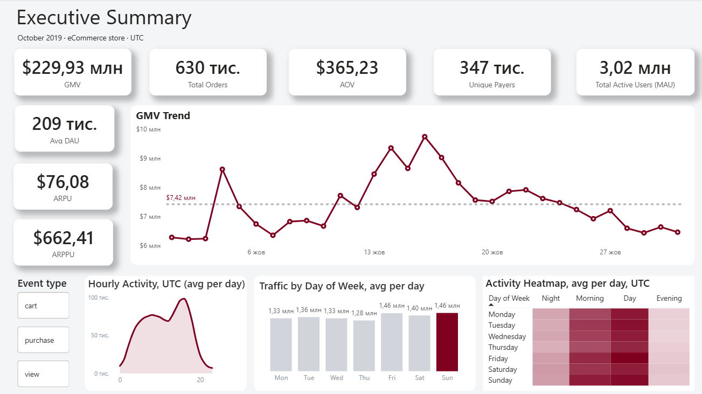
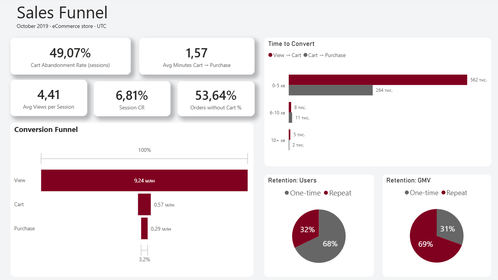
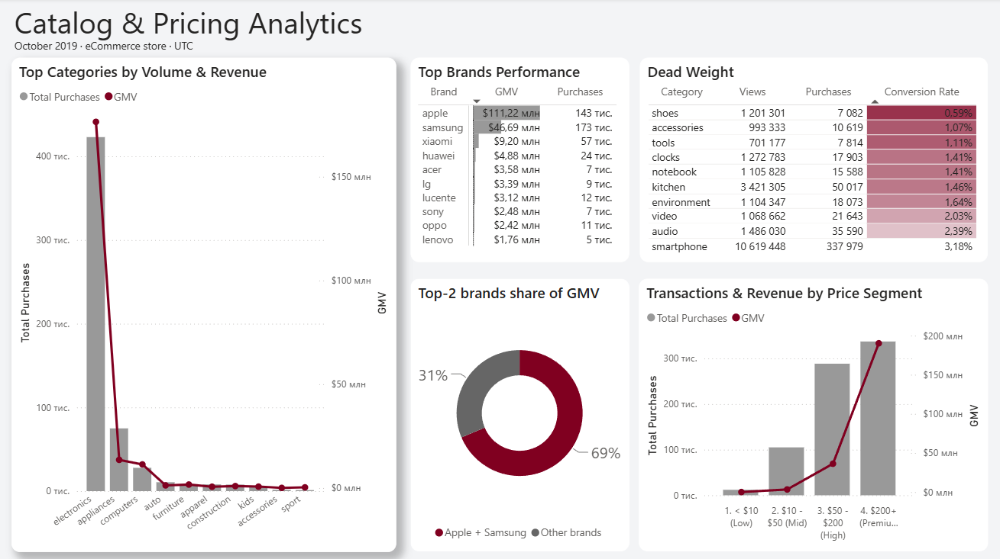
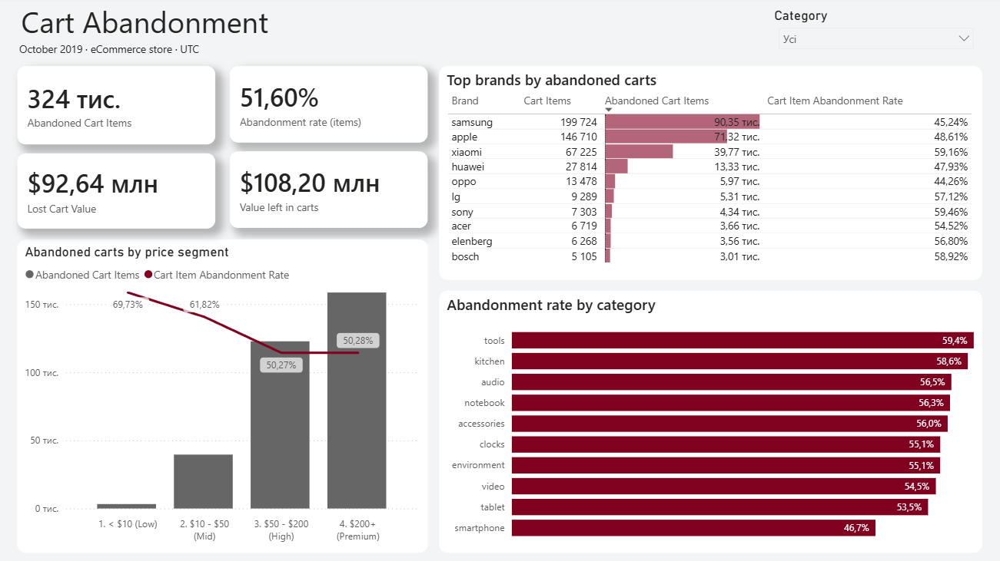

# eCommerce Behavior Analytics

**PostgreSQL · SQL · Power BI (DAX, PBIP)**

🇬🇧 English · [🇺🇦 Українська](README.uk.md)

An end-to-end analysis of **42.4 million user events** from a large multi-category online store in October 2019. Raw clickstream data is cleaned and modelled in PostgreSQL, then turned into a four-page Power BI report that answers a business brief: how healthy is the business, where do we lose customers, what sells, and how much money is left in abandoned carts.

## Report pages

| Page | Questions it answers |
|---|---|
| **Executive Summary** | GMV, orders, AOV, users, ARPU/ARPPU, daily GMV trend, traffic by hour and weekday |
| **Sales Funnel** | Session funnel, conversion, cart abandonment, time to convert, one-time vs repeat buyers |
| **Catalog & Pricing** | Top categories and brands, brand concentration, dead-weight categories, price segments |
| **Cart Abandonment** | Abandoned items and their value, by brand, category and price segment |

### Executive Summary



### Sales Funnel



### Catalog & Pricing



### Cart Abandonment



## Key numbers (October 2019)

| GMV | Orders | AOV | Payers | Active users | Session CR |
|---:|---:|---:|---:|---:|---:|
| **$229.9M** | **629.6K** | **$365.23** | **347.1K** | **3.02M** | **6.81%** |

## Key insights

1. **Two brands carry the business.** Apple and Samsung bring **69% of GMV** ($157.9M). Samsung sells more units (173K vs 143K), but Apple earns more than twice the revenue thanks to a higher price point. This concentration is a supplier risk.
2. **Repeat buyers are the most valuable customers.** Only **32% of payers** ordered more than once, yet they generated **69% of GMV**. A loyalty or retention programme has the biggest upside.
3. **More than half of orders skip the cart.** **53.6%** of orders happen without an add-to-cart event (likely "buy now"). That is why the classic view → cart → purchase funnel ends at 3.2% while the real session conversion is 6.8%.
4. **Buyers decide fast.** Once a product is in the cart, the purchase follows in **1.6 minutes** on average, and 95% of cart → purchase steps take under 5 minutes.
5. **$92.6M is never recovered from abandoned carts.** Users left **$108.2M** of products in carts. **$15.6M** of it was bought later, but **$92.6M** never was. Half of all cart items (51.6%) are abandoned.
6. **Cheap items are abandoned the most.** **70%** of items under $10 are left in the cart, compared with about 50% for items over $50. Small items are probably added "just in case" or to reach a threshold.
7. **Premium products drive revenue.** Items over $200 bring **$190.2M, or 83% of GMV**. Electronics alone accounts for about $176M.
8. **Some categories attract views but not buyers.** Shoes get 1.2M views and convert at only **0.59%**, five times worse than smartphones (3.18%). Accessories (1.07%) and tools (1.11%) follow. These listings need a review of price, photos and stock.
9. **Traffic is stable, sales are not.** Daily traffic varies by only about 15% across weekdays (Sunday is the busiest). GMV, however, averages $7.4M a day and jumps to **$9.7M around 14–17 October**, which is worth checking against the promo calendar.

## Recommendations

- **Win back abandoned carts.** Reminder emails or push notifications within an hour target the $92.6M that is never recovered.
- **Grow repeat purchases.** Loyalty offers for first-time buyers turn the 68% one-time majority into the most valuable segment.
- **Reduce brand dependency.** Promote strong third brands (Xiaomi, Huawei) to lower the 69% reliance on Apple and Samsung.
- **Fix the dead weight.** Audit the shoes, accessories and tools listings, where views are high and conversion is the lowest.
- **Use the low-price abandonment.** Bundles or a free-shipping threshold can turn cheap cart items into add-ons to larger orders.

## Data

- **Source:** [eCommerce behavior data from multi category store](https://www.kaggle.com/datasets/mkechinov/ecommerce-behavior-data-from-multi-category-store) (Kaggle, REES46 Open CDP), file `2019-Oct.csv`.
- **Size:** 42 448 764 events, 3.02M users, 9.24M sessions.
- **Fields:** event time, event type (`view`, `cart`, `purchase`), product, category, brand, price, user and session.

## Approach

1. **Exploration** (`02`): profiled gaps, zero prices, bot sessions, duplicate purchases and price changes. See [docs/data_quality.md](docs/data_quality.md).
2. **Cleaning** (`03`): removed 4 bot sessions (> 500 events), 76 duplicate purchases and 2 incomplete rows. 3 522 rows in total (0.008%), with no effect on GMV.
3. **Modelling** (`03`–`05`): built a star schema with an event fact table, session, funnel and cart-item fact tables, and product and user dimensions. See [docs/data_model.md](docs/data_model.md).
4. **Validation** (`06`): reconciled GMV between tables, checked referential integrity, and produced reference KPIs.
5. **Reporting** (Power BI): DirectQuery to PostgreSQL, DAX measures organised in display folders, and every KPI reconciled with SQL. See [docs/kpi_definitions.md](docs/kpi_definitions.md).

### Decisions worth noting

- **Order = session with a purchase**, because the data has no order ID.
- **Revenue uses the price at the moment of purchase**, not the latest product price. 57 550 products changed price during the month, and using the latest price would understate GMV by $2.9M.
- **Funnel metrics are session based** (`fact_sessions`), so cards and the funnel chart agree.
- **Two abandonment rates** are shown on purpose: 49.1% of sessions with a cart end without a purchase, and 51.6% of individual cart items are not bought.

## Repository structure

```
├── sql/
│   ├── 01_import_raw_data.sql            # schemas, staging table, CSV load
│   ├── 02_exploratory_data_analysis.sql  # data profiling and anomaly checks
│   ├── 03_build_fact_events.sql          # cleaned event fact table
│   ├── 04_build_dimensions.sql           # dim_products, dim_users
│   ├── 05_session_funnel_prep.sql        # fact_funnel_steps, fact_sessions, fact_cart_items
│   └── 06_data_validation.sql            # integrity checks and reference KPIs
├── powerbi/
│   ├── ecommerce_behavior_analytics.pbip # Power BI project (open this file)
│   ├── ecommerce_behavior_analytics.SemanticModel/  # model, relationships, DAX measures (TMDL)
│   ├── ecommerce_behavior_analytics.Report/         # report pages and visuals
│   └── validation_query.dax              # DAX query to reconcile measures with SQL
└── docs/
    ├── business_requirements.md          # the brief the report answers
    ├── data_model.md                     # tables, grain, columns, relationships
    ├── data_quality.md                   # profiling results and cleaning rules
    ├── kpi_definitions.md                # every metric, its DAX measure and value
    └── images/                           # report screenshots
```

## How to reproduce

1. Install PostgreSQL and Power BI Desktop.
2. Download `2019-Oct.csv` from Kaggle and update the file path in `sql/01_import_raw_data.sql`.
3. Run the SQL scripts in order: `01`, `03`, `04`, `05`, then `06` to validate. `02` is optional exploration.
4. Open `powerbi/ecommerce_behavior_analytics.pbip`. The model connects to `localhost`, database `postgres`, schema `analytics`. Change the connection in Power Query if your setup is different.
5. Optional: run `powerbi/validation_query.dax` in DAX query view and compare the results with query 6 in `06_data_validation.sql`.

## Limitations

- One month of data, so there is no month-over-month trend or long-term retention.
- No order ID or quantity: orders are approximated by sessions, and two identical purchases in the same second count as one.
- The October file has no `remove_from_cart` events.
- All times are in UTC. The store's local time zone is not given.
