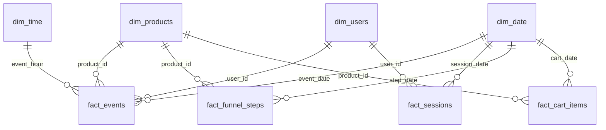

# Data model

The database has two layers in PostgreSQL:

- **`staging`**: raw events loaded from the CSV without any changes.
- **`analytics`**: a cleaned star schema that Power BI reads in DirectQuery mode.

## Lineage

| Table | Built from | Script |
|---|---|---|
| `staging.raw_events` | `2019-Oct.csv` | `01_import_raw_data.sql` |
| `analytics.fact_events` | `staging.raw_events` | `03_build_fact_events.sql` |
| `analytics.dim_products` | `staging.raw_events` | `04_build_dimensions.sql` |
| `analytics.dim_users` | `analytics.fact_events` | `04_build_dimensions.sql` |
| `analytics.fact_funnel_steps` | `analytics.fact_events` | `05_session_funnel_prep.sql` |
| `analytics.fact_sessions` | `analytics.fact_events` | `05_session_funnel_prep.sql` |
| `analytics.fact_cart_items` | `analytics.fact_events` | `05_session_funnel_prep.sql` |
| `dim_date`, `dim_time` | DAX calculated tables | Power BI |

Run order: `01 → (02) → 03 → 04 → 05 → 06`. Script 02 is exploratory only and 06 is validation only.

## Schema

All relationships are many-to-one with a single filter direction (from dimension to fact).

## staging.raw_events

Raw events as published. 42 448 764 rows.

| Column | Type | Description |
|---|---|---|
| event_time | timestamp | Event time (UTC) |
| event_type | varchar(50) | `view`, `cart` or `purchase` |
| product_id | bigint | Product ID |
| category_id | bigint | Category ID |
| category_code | varchar(255) | Category path, e.g. `electronics.smartphone`. Empty for 31.84% of events |
| brand | varchar(255) | Brand in lower case. Empty for 14.40% of events |
| price | numeric(10,2) | Product price at the time of the event |
| user_id | bigint | Permanent user ID |
| user_session | varchar(255) | Session ID. Changes when a user returns after a long pause |

## analytics.fact_events

**Grain:** one row = one event after cleaning. 42 445 242 rows.

Cleaning removes bot sessions (more than 500 events), duplicate purchases, purchases with price ≤ 0, and rows without `product_id`, `user_id` or `user_session`. See [data_quality.md](data_quality.md).

| Column | Type | Description |
|---|---|---|
| event_time | timestamp | Event time (UTC) |
| event_date | date | Event date. Joins `dim_date` |
| event_hour | integer | Hour 0–23 (UTC). Joins `dim_time` |
| event_type | text | `view`, `cart` or `purchase` |
| product_id | bigint | Joins `dim_products` |
| user_id | bigint | Joins `dim_users` |
| user_session | varchar | Session ID |
| price | numeric(10,2) | Price at the time of the event. **Use this column for revenue** |
| price_segment | text | `1. < $10 (Low)`, `2. $10 - $50 (Mid)`, `3. $50 - $200 (High)`, `4. $200+ (Premium)` |

The number prefix in the segment names makes Power BI sort them in a logical order instead of alphabetically.

Indexes: `product_id`, `user_id`, `event_date`, `user_session`, `event_type`.

## analytics.dim_products

**Grain:** one row = one product. Primary key: `product_id`.

| Column | Type | Description |
|---|---|---|
| product_id | bigint | Primary key |
| category_id | bigint | Category ID (hidden in Power BI) |
| category_code | varchar | Full category path |
| brand | varchar | Brand. `Unknown` when empty |
| last_price | numeric | Last known price (hidden in Power BI). Not used for revenue |
| category_level_1 | text | Top-level category, e.g. `electronics`. `Other` when the path is empty |
| category_level_2 | text | Subcategory, e.g. `smartphone`. Falls back to level 1 when there is no second level. `Other` when the path is empty |

One source row is kept per product: rows with a filled `category_code` first, then the most recent.

## analytics.dim_users

**Grain:** one row = one user. Primary key: `user_id`. Built from the cleaned fact table, so users seen only in bot sessions are excluded.

## analytics.fact_funnel_steps

**Grain:** one row = a move between two different consecutive steps of the same product within a session, e.g. `view → cart`.

| Column | Type | Description |
|---|---|---|
| user_session | varchar | Session ID |
| user_id | bigint | User ID |
| product_id | bigint | Joins `dim_products` |
| current_step | text | Current step |
| next_step | text | Next step |
| step_time | timestamp | Time of the current step |
| next_step_time | timestamp | Time of the next step |
| minutes_to_next_step | numeric | Minutes between the two steps |
| step_date | date | Generated from `step_time`. Joins `dim_date` |

When two steps share a timestamp, the logical order `view < cart < remove_from_cart < purchase` decides. Repeats in a row (`view → view`) are skipped. In Power BI, the calculated column `Time_Cohort` groups `minutes_to_next_step` into `0-5 хв`, `6-10 хв` and `10+ хв`.

## analytics.fact_sessions

**Grain:** one row = one session. Primary key: `user_session`. 9 244 417 rows.

| Column | Type | Description |
|---|---|---|
| user_session | varchar | Primary key |
| user_id | bigint | User ID |
| session_start / session_end | timestamp | First and last event of the session |
| session_date | date | Date of the session start. Joins `dim_date` |
| views | bigint | Number of views |
| carts | bigint | Number of add-to-cart events |
| removes | bigint | Number of removals from cart. Always 0 in October 2019 data (hidden in Power BI) |
| items_purchased | bigint | Number of units sold |
| distinct_products_viewed | bigint | Unique products viewed in the session |
| gmv | numeric | Sum of purchase prices in the session |
| has_cart | boolean | The session had at least one add to cart |
| has_purchase | boolean | The session had a purchase. **A session with a purchase = an order** |
| first_cart_time | timestamp | Time of the first add to cart |
| first_purchase_time | timestamp | Time of the first purchase |

## analytics.fact_cart_items

**Grain:** one row = one product added to cart in a session. Primary key: (`user_session`, `product_id`).

| Column | Type | Description |
|---|---|---|
| user_session | varchar | Session ID |
| user_id | bigint | User ID |
| product_id | bigint | Joins `dim_products` |
| first_cart_time | timestamp | First time the product was added to cart in the session |
| cart_date | date | Date of `first_cart_time`. Joins `dim_date` |
| cart_events | bigint | How many times the product was added in the session |
| cart_price | numeric | Price at the first add to cart |
| price_segment | text | Same segments as `fact_events`, plus `5. Unknown` for zero prices |
| purchased_same_session | boolean | Bought in the same session after being added. `FALSE` = abandoned |
| purchased_later | boolean | Bought by the same user in any session after being added |

## Power BI tables

| Table | Description |
|---|---|
| `dim_date` | Calendar for 1–31 October 2019: date, day of month, day of week (Monday = 1), weekday or weekend |
| `dim_time` | Hours 0–23 with a time of day bucket: Night (0–5), Morning (6–11), Day (12–17), Evening (18–23) |
| `_Measures` | Holds all DAX measures, grouped in display folders. See [kpi_definitions.md](kpi_definitions.md) |
